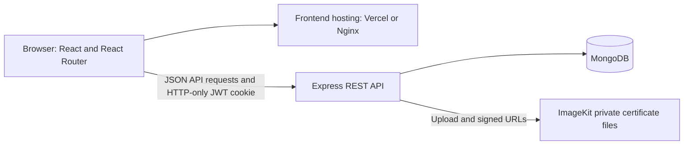

<div align="center">

# Proofolio

### A clearer record of student achievement.

Proofolio brings student portfolios, faculty certificate review, and academic mentoring together in one institution-focused platform.

[](https://react.dev/)
[](https://vite.dev/)
[](https://nodejs.org/)
[](https://expressjs.com/)
[](https://www.mongodb.com/)
[](https://tailwindcss.com/)

</div>

## Contents

- [Overview](#overview)
- [Features](#features)
- [Technology](#technology)
- [Architecture](#architecture)
- [Project structure](#project-structure)
- [Getting started](#getting-started)
- [Environment variables](#environment-variables)
- [Security and implementation notes](#security-and-implementation-notes)
- [Deployment](#deployment)
- [License](#license)
- [Project link](#project-link)

## Overview

Student certificates and achievement records often end up spread across email, cloud drives, and personal documents. That makes it harder for students to maintain a useful portfolio and for academic departments to review credentials consistently.

Proofolio provides students with a place to submit and track achievements, faculty with branch-scoped certificate review and mentoring tools, and administrators with institutional directories and oversight.

## Features

### 🎓 Students

- Create an account with academic profile details and maintain the student profile.
- Submit achievements with a certificate file, category, organization, date, and description.
- Filter and review personal records by status, including pending, verified, and rejected submissions.
- View faculty feedback on rejected submissions and remove their own achievement records.
- See assigned faculty mentors, mentoring sessions, shared goals, and action items; update action-item progress.
- Receive mentoring notifications.

### 🧑‍🏫 Faculty

- Register for a faculty account, which must be approved by an administrator before access.
- Browse students and review student certificate submissions within the faculty member's assigned branch.
- Verify certificates or reject them with feedback.
- View a faculty profile and manage personal certificate records.
- Assign and manage mentees, schedule and update mentoring sessions, write session reports, and track goals and action items.
- View mentoring notifications.

### 🛡️ Admin

- View institutional overview statistics and recent student registrations.
- Search student and faculty directories and inspect student details.
- Browse student and faculty certificate records and filter certificate listings.
- Approve or reject faculty registrations.
- Assign or clear faculty branch assignments.

> **Branch access:** Faculty student access, mentoring, and certificate review are restricted to the branch configured on each faculty profile. New faculty accounts are not assigned a branch automatically. An administrator should verify the faculty record before assigning a branch; unassigned faculty cannot access branch-scoped student features. Existing profiles remain unchanged until an administrator makes an assignment; no data backfill is required.


## Technology

| Area | Implementation |
| --- | --- |
| Frontend | React 19, React Router 7, Vite 8 |
| Styling | Tailwind CSS 4 |
| Backend | Node.js, Express 5 |
| Database | MongoDB with Mongoose |
| Certificate files | ImageKit private-file storage with signed delivery URLs |
| Authentication | JWT in an HTTP-only cookie; `bcryptjs` password hashing |
| Tests | Node.js built-in test runner (`node --test`) |
| Deployment options in the repository | Vercel rewrites for the frontend; Dockerfiles, Nginx, and Docker Compose |

## Architecture



The Vite frontend calls the Express API at `VITE_API_URL` (default `http://localhost:3000`). The API uses Mongoose for application data and ImageKit for uploaded certificate files. The frontend's Vercel configuration handles client-side route requests; the Docker frontend image serves the built app through Nginx with an SPA fallback.

## Project structure

```text
Proofolio/
├── Backend/
│   ├── .env.example
│   ├── Dockerfile
│   ├── package.json
│   ├── server.js
│   ├── src/
│   │   ├── controllers/
│   │   ├── db/
│   │   ├── middlewares/
│   │   ├── models/
│   │   ├── routes/
│   │   └── services/
│   └── test/
├── Frontend/
│   ├── .env.example
│   ├── Dockerfile
│   ├── nginx.conf
│   ├── package.json
│   ├── vercel.json
│   └── src/
│       ├── components/
│       ├── config/
│       ├── context/
│       └── pages/
├── docker-compose.yml
└── README.md
```

## Getting started

### Prerequisites

- Node.js 22 and npm.
- A MongoDB database accessible to the backend.
- An ImageKit account and credentials to upload and serve certificate files.

### 1. Clone the repository

```sh
git clone https://github.com/MariyaAnjum937/Proofolio.git
cd Proofolio
```

### 2. Configure and start the backend

In a terminal at the repository root:

```sh
cd Backend
npm install
```

Create a local backend environment file from the example. In PowerShell:

```powershell
Copy-Item .env.example .env
```

Edit `Backend/.env` and provide your own database URL, JWT secret, and ImageKit credentials. Do not commit this file.

Start the API:

```sh
npm start
```

The server listens on port `3000` by default. The frontend expects the API at `http://localhost:3000` unless `VITE_API_URL` is set.

### 3. Configure and start the frontend

Open a second terminal at the repository root:

```sh
cd Frontend
npm install
```

The API URL defaults to `http://localhost:3000`, so no frontend environment file is necessary for the standard local setup. To set it explicitly, copy the example to `.env.local` and edit it:

```powershell
Copy-Item .env.example .env.local
```

Run the Vite development server:

```sh
npm run dev
```

Open the local URL printed by Vite (normally `http://localhost:5173`).

### Tests and production build

Run each command block from the repository root (open another terminal or return to the root first).

Run backend tests:

```sh
cd Backend
npm test
```

Build and lint the frontend:

```sh
cd Frontend
npm run build
npm run lint
```

### Optional: Docker Compose

Docker Compose builds both services. It reads backend values from `Backend/.env`, so create and configure that file as described above before running:

Run this command from the repository root:

```sh
docker compose up --build
```

The Compose configuration publishes the frontend on port `5173` and the backend on port `3000`.

## Environment variables

The committed example files contain placeholders only. Replace them in your local or hosting environment; never put real credentials in source control.

### Backend (`Backend/.env`)

| Variable | Required | Purpose |
| --- | --- | --- |
| `MONGO_URL` | Yes | MongoDB connection string used by Mongoose. |
| `JWT_SECRET` | Yes | Secret used to sign and verify authentication JWTs. Use a strong private value. |
| `IMAGEKIT_PRIVATE_KEY` | For certificate uploads | Private ImageKit API key used by the backend when uploading private certificate files. |
| `IMAGEKIT_PUBLIC_KEY` | For certificate uploads | ImageKit public key used to initialize the upload client. |
| `IMAGEKIT_URL_ENDPOINT` | For certificate uploads and signed URLs | ImageKit URL endpoint for uploaded files and signed delivery links. |
| `ADMIN_REGISTRATION_SECRET` | Only for initial admin registration | Secret required by the admin-registration endpoint. The endpoint only creates an admin when no admin already exists. Keep this server-side and private. |
| `PORT` | No | Backend listen port; defaults to `3000`. |
| `NODE_ENV` | No | Set to `production` in production; controls secure, cross-site authentication cookie settings. |
| `RENDER` | No | Set to `true` on Render deployments when `NODE_ENV` is not set to production; also enables production cookie settings. |

### Frontend (`Frontend/.env.local`)

| Variable | Required | Purpose |
| --- | --- | --- |
| `VITE_API_URL` | No | Base URL of the Express API. Defaults to `http://localhost:3000`; set it to the deployed API origin when building the frontend for another environment. |

The API's CORS allow-list is currently configured in `Backend/src/app.js` for local development and the Vercel origin already present in the source. If the frontend is hosted at another origin, update the backend allow-list to match; setting `VITE_API_URL` alone does not change CORS policy.

## Security and implementation notes

- Passwords are hashed with `bcryptjs`; the backend issues JWTs in an HTTP-only cookie.
- Production cookie settings use `Secure` and `SameSite=None`; local development uses `SameSite=Lax` without `Secure`.
- API routes apply authentication and role authorization middleware. Faculty branch-scoped routes also check the faculty member's configured branch; pending or rejected faculty cannot use protected faculty features.
- Student certificate uploads accept PDF, JPEG, PNG, and WebP files up to 10 MB. ImageKit files are uploaded as private files, and API responses use signed certificate URLs with a one-hour default lifetime.
- React route guards improve the client experience; API middleware remains responsible for server-side authorization.
- Faculty branch assignments are explicit administrator actions. Existing unassigned profiles remain unassigned; no branch is inferred from department data.

## Deployment

- **Vercel frontend:** `Frontend/vercel.json` rewrites the application's current frontend route paths to `index.html` so direct navigation and reloads reach React Router.
- **Docker frontend:** `Frontend/Dockerfile` builds the Vite app and serves `dist` with Nginx. `Frontend/nginx.conf` includes an SPA fallback.
- **Backend:** `Backend/Dockerfile` runs the Express API; `docker-compose.yml` defines the local two-container setup.

Configure the backend environment variables and the frontend's `VITE_API_URL` for your deployment. If using a new frontend origin, add it to the backend CORS allow-list in `Backend/src/app.js`. The repository does not document a deployment dashboard URL or a hosted demo.

## License

There is no root `LICENSE` file in the repository. `Backend/package.json` declares `ISC` package metadata, but confirm whether that is the intended license for the project as a whole and add a root license file before redistributing.

## Project link

[MariyaAnjum937/Proofolio on GitHub](https://github.com/MariyaAnjum937/Proofolio)
